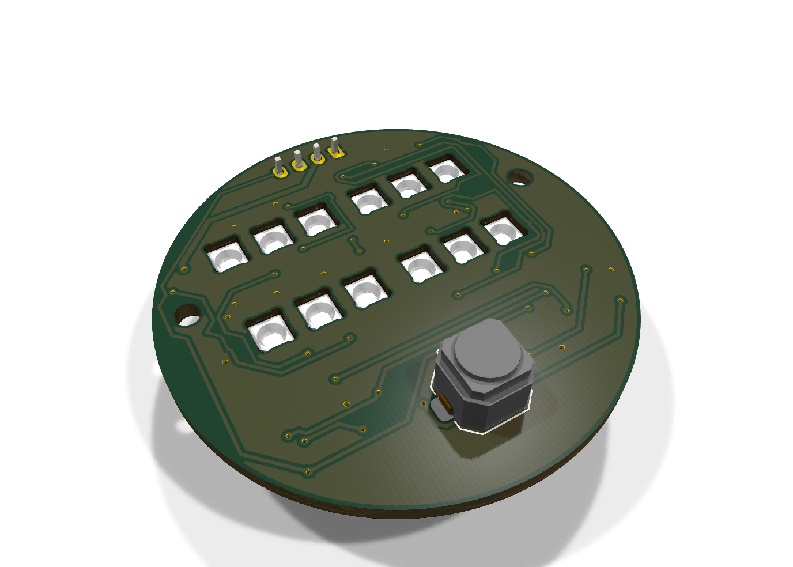

# Bolty Mood Module

A 40 mm round, 2-layer PCB that gives the Bolty robot a face. An ATtiny85 drives two 3×2 "eyes" made of
12 reverse-mount SK6812MINI-E RGB LEDs, plus a buzzer and a pat button. The main robot sets the mood over
I2C at address `0x42`.

## Specs

| | |
|---|---|
| Board | 40 mm round, 2 layers, 1.6 mm FR-4 |
| MCU | ATtiny85-20SU (SOIC-8 wide), 8 MHz internal |
| LEDs | 12 × SK6812MINI-E, mounted on the back, shining through square holes |
| Sound | CMT-8504 magnetic buzzer, driven by an MMBT3904 |
| Input | 6 × 6 mm tactile button on the face |
| Connector | JST-PH 4-pin: GND, +5V, SCL, SDA |
| Programming | 2 × 3 ISP pads on the back |
| Interface | I2C slave `0x42`, write one byte: 0 idle, 1 happy, 2 sad, 3 angry, 4 sleepy, 5 surprised |

## Folders

| Path | Contents |
|---|---|
| `DESIGN.md` | Design notes: parts, pinout, LED layout |
| `BUILD.md` | Order → solder → program → test guide |
| `JOURNAL.md` | Build journal |
| `kicad/` | KiCad 10 project (schematic, PCB, custom symbol and footprint libraries) |
| `fab/` | Gerbers, drill files, BOM with buy links, positions, assembly PDFs, STEP model |
| `firmware/bolty_mood/` | ATtiny85 test firmware (ATTinyCore) |
| `tools/` | Python scripts that generated the schematic and board and ran the autorouter |
| `reel/` | Progress images and video |

## Status

- [x] Schematic (ERC clean)
- [x] PCB layout and routing (DRC: 0 errors, 0 unconnected, 0 schematic mismatches)
- [x] Fabrication files and BOM
- [ ] PCBs ordered
- [ ] Assembled and tested

## Credits

Designed with help from Claude Code (AI). See `JOURNAL.md` for who did what.
